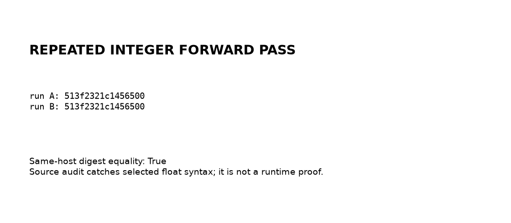
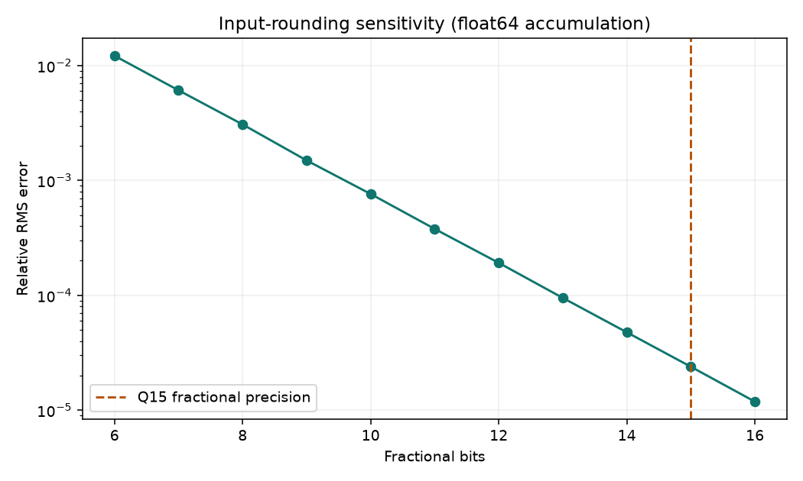

# bitforge

## What does an integer inference path actually promise?

Not “the same answer on every accelerator.” This project makes a smaller,
inspectable promise: Q15 matrix primitives implemented with integer NumPy
operations, explicit storage boundaries, a float64 comparison path, and a
source audit that catches selected accidental float operations.

It is an arithmetic lab, **not a complete transformer, model converter, or
optimized inference runtime**. It contains no CUDA kernel or trained model.



### Start with the failure boundary

A signed int16 cannot hold the sum of hundreds of Q15 products. The important
choice here is not the bit-width label; it is keeping accumulators wide until
the caller explicitly rescales and narrows them.

```text
int16 operands → int64 products and sum → rounded Q15 int64 result
                                               ↓ caller-selected shift
                                    checked int16 storage → next layer
```

`matmul_q15` and `gemv_q15` enforce int16 inputs and a reduction dimension
of at most 4096. Products accumulate in int64. Adding 2^14 then shifting by
15 rounds the fixed-point result; ties are biased upward, not ties-to-even.
`requantize_to_int16` rejects an out-of-range accumulator rather than silently
wrapping it. Apply ReLU only at an already-safe storage boundary: it is not
an overflow detector.

The softmax approximation has a narrower contract than a general softmax:
**after subtracting the row maximum, every logit must be in [-1, 0] in real
units**. Integer repeated squaring approximates the exponential, followed by
reciprocal-based integer normalization. Scaling logits to fit that interval
changes the probability distribution even when it preserves argmax.

### The experiment, including the inconvenient part

Run from this checkout with Python 3.11 or newer:

```sh
python -m pip install -e '.[dev,viz]'
python benchmarks/run.py
python demos/make_figures.py
python -m pytest tests -q
python -m ruff check .
python -m mypy bitforge
python -m build --wheel
```

The benchmark writes [the receipt](receipts/receipt.json). On the seeded
512-by-512 comparison, the measured relative RMS error was **2.39564e-5**
against float64. The two seeded integer forward passes produced the same
recorded digest prefix, `513f2321c1456500`.

The softmax report says 100% argmax agreement **on its filtered subset**.
That is not 100% agreement over all samples: the bits=3 run excludes 58% of
rows, and the separately seeded bits=4 run excludes 59.5%. The filter uses a
fixed probability-margin threshold, not a proved approximation bound. The
observed maximum probability deviations were 0.00534 and 0.00239. Different
seeds mean these two rows are not a controlled bit-depth comparison.



This second experiment rounds inputs at different fractional precisions but
accumulates in float64. It isolates input-quantization error; it does **not**
measure integer-kernel performance or output-rounding error. Its complete
values and method are in [bit_sweep.json](receipts/bit_sweep.json).

### Where the engineering is

- **Width transitions are visible:** accumulator results are not silently
  squeezed back into int16 after every matrix operation.
- **The audit is executable:** `lint_forward()` checks float literals, true
  division and selected constructors/dtype attributes in forward modules.
  Float conversion and reference modules are intentionally exempt.
- **The reference is separate:** accuracy can be inspected without inserting
  floating-point operations into the arithmetic being evaluated.

The audit is a syntactic guardrail, not a proof of arbitrary runtime dtype
flow. Aliased calls and unrecognized APIs can escape it. Passing the tests
also does not prove cross-platform determinism, model-level quality, or speed
relative to a float implementation.

### Read the implementation

[Integer arithmetic](bitforge/intmath.py) owns the numerical contract;
[source audit](bitforge/lint.py) owns the lint rules;
[reference study](bitforge/reference.py) owns the comparison and its filter.
The demo is a small two-stage matrix-vector path, not a transformer block.

Fixed-point arithmetic and integer inference are established techniques.
For context, see Jacob et al., [Quantization and Training of Neural Networks
for Efficient Integer-Arithmetic-Only Inference](https://arxiv.org/abs/1712.05877).
This repository's contribution is the inspectable experiment and explicit
boundaries, not a new quantization algorithm or a reproduction of that paper.

MIT licensed. CPU execution only is evidenced here; remote CI and GPU
performance have not been verified.
